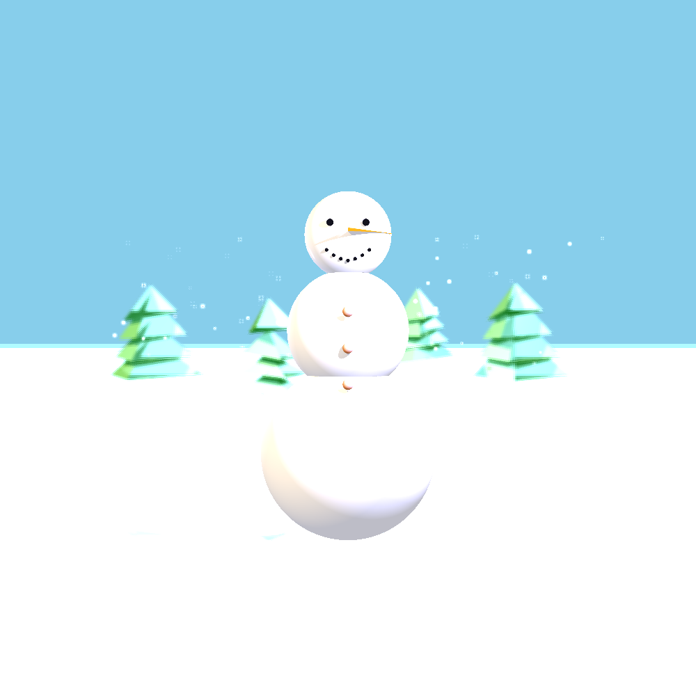
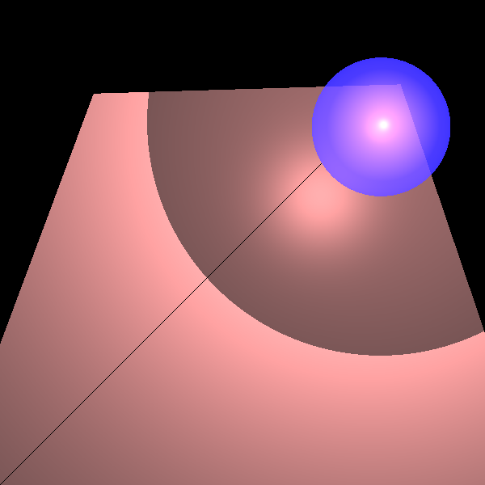
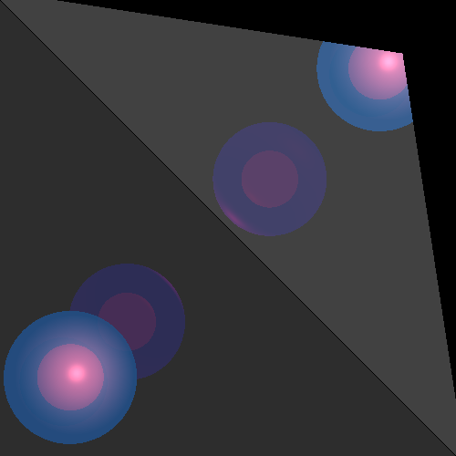
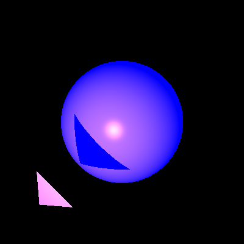
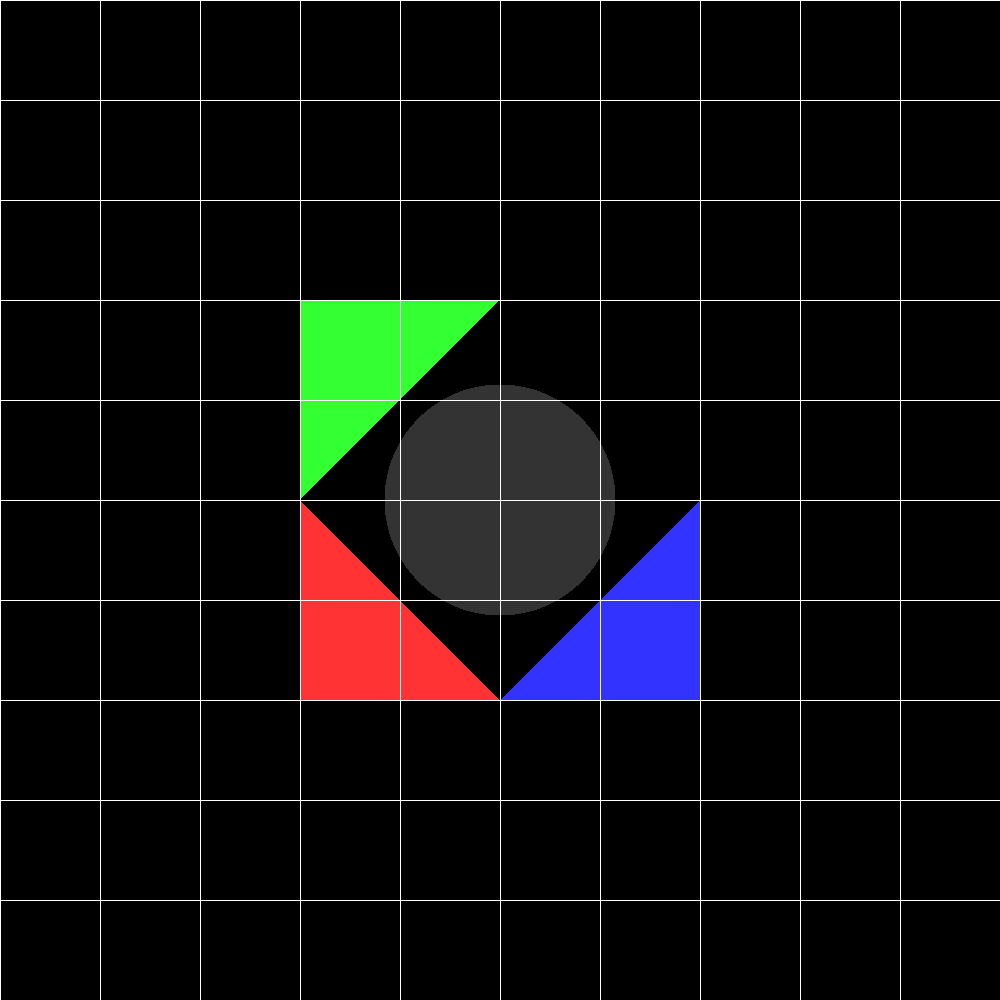

# 3D Ray Tracing Engine (ISE 5784)

<div align="center">


**מנוע רינדור תלת-ממדי (Ray Tracer) מתקדם ב-Java**  
פרויקט גמר בקורס **מבוא להנדסת תוכנה** (תשפ"ד / 2024) – המרכז האקדמי לב (מכון טל)  
**מפתחות:** תהילה טננבאום & מעין אנסבכר

</div>

---

## תוכן עניינים (Table of Contents)
1. [סקירת הפרויקט](#-סקירת-הפרויקט-overview)
2. [גלריית תמונות ותוצרי רינדור (Gallery)](#-גלריית-תוצרי-רינדור-showcase)
3. [תכונות המנוע ויכולות אופטיות (Features)](#-תכונות-המנוע-ויכולות-אופטיות)
   - [חישובים גאומטריים ואנליטיים](#1-מנוע-גאומטרי-ותשתית-וקטורית-primitives--geometries)
   - [מודל תאורה מתקדם (Phong Model)](#2-מודל-תאורה-והצללה-phong-illumination-model)
   - [השתקפויות ושבירת אור רקורסיביות](#3-השתקפות-מראה-ושבירת-אור-רקורסיבית-reflection--refraction)
4. [שדרוגים מתקדמים (Mini-Projects)](#-שדרוגים-מתקדמים-mini-projects)
   - [עומק שדה (Depth of Field)](#-עומק-שדה-depth-of-field---mp1)
   - [דגימת-על אדפטיבית (Adaptive Super Sampling)](#-דגימת-על-אדפטיבית-adaptive-super-sampling---mp2)
   - [ריבוי תהליכונים וביצועים (Multithreading)](#-ריבוי-תהליכונים-וביצועים-multithreading)
5. [ארכיטקטורה ותבניות עיצוב (Design Patterns)](#-ארכיטקטורת-תוכנה-ותבניות-עיצוב)
6. [מבנה הפרויקט (Project Structure)](#-מבנה-התיקיות-והמחלקות)
7. [בדיקות ופיתוח מונחה בדיקות (TDD)](#-בדיקות-ופיתוח-מונחה-בדיקות-tdd)
8. [הוראות התקנה והרצה (Getting Started)](#-הוראות-התקנה-והרצה)
9. [דוגמת קוד לשימוש במנוע](#-דוגמת-קוד-ליצירת-סצנה-ורינדור)

---

## 🌟 סקירת הפרויקט (Overview)

פרויקט זה מממש **מנוע רינדור תלת-ממדי מבוסס מעקב קרניים (Whitted-style Ray Tracer)** שנכתב כולו ב-**Java** ללא שימוש בספריות גרפיות חיצוניות, תוך יישום עקרונות הנדסת תוכנה מתקדמים, תבניות עיצוב (Design Patterns) ומתודולוגיית TDD (Test-Driven Development).

המנוע מדמה את התנהגותן הפיזיקלית של קרני אור במרחב תלת-ממדי:
* יצירת קרניים מנקודת המבט של המצלמה דרך מישור הצפייה (View Plane).
* חישוב נקודות חיתוך גאומטריות מדויקות עם מגוון גופים תלת-ממדיים.
* חישוב תאורה מקומית לפי מודל פון (דיפוזי, ספקולרי, פליטה ואור סביבתי).
* מעקב רקורסיבי אחר קרניים משניות להפקת השתקפויות מראה (Reflection), שבירת אור דרך עצמים שקופים (Refraction) וצללים חלקיים.
* סימולציית מצלמה אמיתית עם עומק שדה (Depth of Field) להשגת אפקט Bokeh.
* אלגוריתם דגימת-על אדפטיבית (Adaptive Super Sampling) להחלקת קצוות וסילוק Aliasing ביעילות מקסימלית.
* מאיץ ביצועים מבוסס ריבוי תהליכונים (Multithreading) עם ניהול תורים דינמי ומעקב אחר התקדמות.

---

## 🖼️ גלריית תוצרי רינדור (Showcase)

### ☃️ סצנת הדגל: איש השלג באגם הקפוא (The Snowman Scene)
תמונת הדגל של הפרויקט מדגימה את כלל יכולות המנוע:
* **עומק שדה (DoF):** איש השלג נמצא במישור המיקוד (Focal Plane) בחדות מלאה, בעוד עצי המחט שברקע מטושטשים ברכות טבעית.
* **השתקפויות מראה (Reflection):** משטח האגם הקפוא משקף את גופו של איש השלג ואת העצים.
* **תאורה מורכבת:** שילוב של תאורה סביבתית, מקור אור נקודתי (PointLight), אור שמש כיווני (DirectionalLight) ושני זרקורים (SpotLights).
* **גאומטריות מגוונות:** עשרות ספרות (גוף, עיניים, כפתורים, חיוך, פתיתי שלג מרחפים) ומשולשים מרובים להרכבת 4 עצי אשוח תלת-ממדיים ואפו של איש השלג.
* **דגימת-על אדפטיבית (Anti-Aliasing):** קווי מתאר חלקים ונקיים.

<div align="center">



*איור 1: סצנת איש השלג – עומק שדה (DoF), השתקפות על קרח, פתיתי שלג ותאורת זרקורים.*

</div>

---

### 🔮 השתקפויות, שבירות אור וצללים

| שקיפות וצל חלקי (Refraction & Partial Shadows) | השתקפות מראות רקורסיבית (Mirrored Reflections) |
| :---: | :---: |
|  |  |
| כדור כחול שקוף למחצה ($k_t$) המטיל צל חלקי רך על שני משולשים אדומים בהארת זרקור. | מראות מוצלבות בזווית המפיקות השתקפויות רקורסיביות אינסופיות של ספירות שקופות ואטומות. |

| הצללה מלאה (Hard Shadows) | חלוקת רשת פיקסלים (View Plane Grid Test) |
| :---: | :---: |
|  |  |
| בדיקת הטלת צל חד ממשולש על גבי ספירה דיפוזית עם נקודת אור ספקולרית. | בדיקת שכבת רשת (Grid Overlay) המציגה את מיפוי הפיקסלים במישור הצפייה. |

---

## ⚙️ תכונות המנוע ויכולות אופטיות

### 1. מנוע גאומטרי ותשתית וקטורית (`primitives` & `geometries`)
* **`Point` ו-`Vector`**: ייצוג נקודות ווקטורים במרחב תלת-ממדי $\mathbb{R}^3$ כאובייקטים בלתי ניתנים לשינוי (Immutable). מימוש פעולות אלגברה וקטורית: מכפלה סקלרית (Dot Product), מכפלה וקטורית (Cross Product), נורמליזציה, מרחקים וחיבור/חיסור.
* **`Ray`**: ייצוג קרן גאומטרית המוגדרת על ידי נקודת מוצא $\vec{p_0}$ ווקטור כיוון מנורמל $\vec{v}$.
* **`Util`**: ניהול דיוק נומרי באמצעות אפסילון מכונה ($\varepsilon = 10^{-10}$) לטיפול אמין בשגיאות נקודה צפה (Floating-Point Precision).
* **מבחר גופים תלת-ממדיים**:
  * **ספירה (`Sphere`)**: מוגדרת על ידי מרכז ורדיוס. חיתוך גאומטרי מהיר באמצעות חישובים טריגונומטריים.
  * **מישור (`Plane`)**: מוגדר על ידי נקודה ונורמל (או 3 נקודות).
  * **משולש (`Triangle`) ומצולע (`Polygon`)**: מציאת נקודת החיתוך במישור ובדיקה האם הנקודה בתוך המצולע באמצעות מכפלות וקטוריות.
  * **צינור אינסופי (`Tube`) וגליל סגור (`Cylinder`)**: גאומטריות רדיאליות מורכבות עם חישוב נורמלים למעטפת ולבסיסים.
* **תבנית Composite (`Geometries`)**: מאפשרת לקבץ גופים היררכית ולבצע בדיקות חיתוך באופן אחיד ויעיל.

---

### 2. מודל תאורה והצללה (Phong Illumination Model)
חישוב הצבע עבור כל נקודת פגיעה נשען על מודל התאורה הפיזיקלי של פון (Phong Reflection Model):

$$I = I_E + I_A \cdot k_A + \sum_{i} \left( k_D |\vec{l_i} \cdot \vec{n}| + k_S (-\vec{v} \cdot \vec{r_i})^{n_{shininess}} \right) \cdot I_{L_i} \cdot k_{tr}$$

* **תאורת פליטה עצמית ($I_E$)**: צבע הפליטה הטבעי של האובייקט (`emission`).
* **אור סביבתי ($I_A$)**: תאורת רקע אחידה המדמה פיזור אור גלובלי בחלל הסצנה (`AmbientLight`).
* **רכיב דיפוזי ($k_D$)**: פיזור אור שווה לכל הכיוונים ממשטח מחוספס (חוק הקוסינוס של למברט).
* **רכיב ספקולרי ($k_S, n_{shininess}$)**: השתקפות ברק מבריקה של מקור האור לעיני הצופה.
* **מקורות אור נתמכים**:
  * **אור כיווני (`DirectionalLight`)**: קרניים מקבילות ללא דעיכה (מדמה שמש מרוחקת).
  * **אור נקודתי (`PointLight`)**: מקור אור מקומי עם דעיכה לפי מרחק:
    $$\text{Attenuation} = \frac{1}{k_c + k_l d + k_q d^2}$$
  * **זרקור (`SpotLight`)**: מקור אור ממוקד עם כיוון מוגדר, הכולל דעיכת מרחק ודעיכת זווית.

---

### 3. השתקפות מראה ושבירת אור רקורסיבית (Reflection & Refraction)
המנוע מיישם **Whitted Ray Tracing** רקורסיבי:
* **קרני השתקפות (Reflection - $k_R$)**: חישוב קרן מוחזרת לפי חוק ההחזרה הפיזיקלי:
  $$\vec{r} = \vec{v} - 2(\vec{v} \cdot \vec{n})\vec{n}$$
* **קרני שבירה/שקיפות (Refraction - $k_T$)**: מעבר קרן האור דרך עצמים שקופים למחצה.
* **צללים חלקיים (Soft / Partial Shadows)**: חישוב מקדם שקיפות מצטבר $k_{tr}$ לאורך מסלול הקרן ממקור האור לנקודה. עצמים שקופים בדרך מטילים צל חלקי וצבעוני בהתאם למקדמי השקיפות שלהם.
* **מניעת Shadow Acne (הזזת ראש הקרן)**: למניעת פגיעה עצמית של הקרן בגוף שממנו יצאה עקב אי-דיוקים נומריים, ראש הקרן החדשה מוזז במרחק קטן ($\text{DELTA} = 0.1$) לכיוון הנורמל או כנגדו.
* **תנאי עצירת רקורסיה**: עומק מקסימלי (`MAX_CALC_COLOR_LEVEL = 10`) וסף תרומת צבע מינימלי (`MIN_CALC_COLOR_K = 0.001`).

---

## 🚀 שדרוגים מתקדמים (Mini-Projects)

### 📷 עומק שדה (Depth of Field - MP1)
במצלמת חריר פשוטה (Pinhole Camera) כל העצמים בסצנה חדים באותה מידה, דבר שאינו טבעי לצילום אמיתי.  
המנוע כולל סימולציה פיזיקלית של **עדשת מצלמה בעלת מפתח צמצם ומרחק מיקוד**:
1. המצלמה שולחת קרן ראשית ממרכז הצמצם דרך הפיקסל אל עבר **מישור המיקוד (Focal Plane)** במרחק $d_{focus}$, ומאתרת את נקודת המיקוד (Focal Point).
2. בעזרת מחלקת `Blackboard`, מיוצרות נקודות דגימה אקראיות מפוזרות (Jittered Grid) על פני שטח הצמצם (`aperture`).
3. מכל נקודה על הצמצם נשלחת קרן משנית המתמקדת באותה נקודת מיקוד בדיוק.
4. **התוצאה:** עצמים הנמצאים במרחק המיקוד מתקבלים חדים לחלוטין, ואילו עצמים קרובים או רחוקים יותר מקבלים טשטוש רך ועשיר (אפקט Bokeh).

---

### 🎯 דגימת-על אדפטיבית (Adaptive Super Sampling - MP2)
במקום לירות עשרות קרניים לכל פיקסל ללא הבחנה (תהליך איטי ביותר), מומש אלגוריתם **דגימת-על אדפטיבית מבוסס עץ רביעים (Quad-Tree / Adaptive Grid)**:
1. לכל פיקסל נדגמות תחילה רק **4 פינותיו**.
2. **בדיקת הומוגניות:** אם צבעי 4 הפינות זהים (או קרובים עד סף מוגדר), הפיקסל נצבע מיד ללא חישובים נוספים!
3. **פיצול רקורסיבי:** אם מתגלה הבדל בין הצבעים (למשל על גבול של עצם או קו צל חד), הפיקסל מתפצל ל-4 תת-ריבועים והתהליך חוזר על עצמו עד לרמת העומק שהוגדרה (`adaptiveGridDepth`).
4. **התוצאה:** סילוק תופעת המדרגות (Aliasing) ורינדור חלק להפליא, תוך קיצור זמני הרינדור בשיעור ניכר (עד מאות אחוזים!).

---

### ⚡ ריבוי תהליכונים וביצועים (Multithreading)
רינדור תמונה ברזולוציה גבוהה (כגון 1000x1000 פיקסלים) עשוי לדרוש מיליוני קרניים וחישובי חיתוך.  
לשם כך פותחה מערכת מקבילית יעילה:
* **`PixelManager`**: מחלקה המספקת ניהול תורים מבוסס Critical Section מסונכרן (`synchronized`) לחלוקת פיקסלים בין כל הליבות הזמינות במעבד.
* תמיכה בהגדרת מספר תהליכונים רצוי דרך המצלמה (`setMultithreading(n)`).
* הדפסת אחוזי התקדמות חיה ומעקב בזמן אמת בקונסולה (`setDebugPrint(interval)`).

---

## 🏛️ ארכיטקטורת תוכנה ותבניות עיצוב

הפרויקט נבנה בקפידה בהתאם לעקרונות **SOLID** ו-**Clean Code**:

```mermaid
classDiagram
    direction TB
    
    class Point {
        +Double3 xyz
        +add(Vector) Point
        +subtract(Point) Vector
        +distance(Point) double
    }
    
    class Vector {
        +dotProduct(Vector) double
        +crossProduct(Vector) Vector
        +normalize() Vector
    }
    Point <|-- Vector
    
    class Ray {
        +Point p0
        +Vector dir
        +getPoint(double) Point
    }
    
    class Intersectable {
        <<interface>>
        +findGeoIntersections(Ray) List~GeoPoint~
    }
    
    class Geometry {
        <<abstract>>
        +Color emission
        +Material material
        +getNormal(Point)* Vector
    }
    Intersectable <|.. Geometry
    Intersectable <|.. Geometries
    
    Geometry <|-- Sphere
    Geometry <|-- Plane
    Geometry <|-- Triangle
    Geometry <|-- Polygon
    Geometry <|-- Tube
    Tube <|-- Cylinder
    
    class Geometries {
        -List~Intersectable~ intersectables
        +add(Intersectable...)
        +findGeoIntersections(Ray) List~GeoPoint~
    }
    
    class Camera {
        -Point p0
        -Vector vTo, vUp, vRight
        -double width, height, distance
        -double aperture, focusDistance
        -int numOfRays
        +renderImage() Camera
        +writeToImage()
    }
    
    class Builder {
        +setLocation(Point) Builder
        +setDirection(Vector, Vector) Builder
        +setVpSize(double, double) Builder
        +setMultithreading(int) Builder
        +setAdaptiveGrid(int) Builder
        +build() Camera
    }
    Camera +-- Builder
    
    class SimpleRayTracer {
        -Scene scene
        +traceRay(Ray) Color
    }
    RayTracerBase <|-- SimpleRayTracer
    Camera --> RayTracerBase
    Camera --> ImageWriter
    SimpleRayTracer --> Scene
    Scene --> Geometries
```

* **Builder Pattern**: מיושמת במחלקה `Camera.Builder`. מאפשרת יצירת אובייקט מצלמה מורכב הכולל הגדרות מיקום, וקטורי כיוון, מרחקי צמצם, ריבוי תהליכונים ודגימת-על, באופן קריא, בטוח ומוגן מפני מצבים לא תקינים.
* **Composite Pattern**: מיושמת במחלקה `Geometries`. מאפשרת להתייחס לאובייקט גאומטרי בודד ולקבוצה שלמה של גופים (כולל הרכבות מקוננות) באותו אופן בדיוק.
* **Strategy / Template Method**: המחלקה המופשטת `RayTracerBase` מגדירה את ממשק עוקב הקרניים, ומאפשרת החלפה גמישה של אלגוריתמי עקיבה (כגון `SimpleRayTracer`).
* **Immutable Objects**: מחלקות הבסיס (`Point`, `Vector`, `Double3`, `Ray`) הן בלתי ניתנות לשינוי לאחר יצירתן, מה שמבטיח Thread Safety מלא ומונע תופעות לוואי בלתי צפויות.

---

## 📂 מבנה התיקיות והמחלקות

```
ISE5784_9795_2195/
├── src/
│   ├── primitives/              # אלמנטים מתמטיים בסיסיים
│   │   ├── Double3.java         # שלשת מספרים ממשיים ופעולות חשבוניות
│   │   ├── Point.java           # נקודה במרחב תלת-ממדי
│   │   ├── Vector.java          # וקטור תלת-ממדי, מכפלות ונורמליזציה
│   │   ├── Ray.java             # קרן במרחב (מוצא וכיוון)
│   │   ├── Color.java           # ייצוג צבע ב-RGB ופעולות ערבוב והפחתה
│   │   ├── Material.java        # מאפייני חומר (דיפוזי, ספקולרי, שקיפות, השתקפות)
│   │   └── Util.java            # פונקציות עזר וטיפול בדיוק נומרי (Epsilon)
│   ├── geometries/              # גופים תלת-ממדיים ובדיקות חיתוך
│   │   ├── Intersectable.java   # ממשק עצמים הניתנים לחיתוך + רשומת GeoPoint
│   │   ├── Geometry.java        # מחלקה מופשטת לגאומטריות (חומר, פליטה, נורמל)
│   │   ├── Geometries.java      # תבנית Composite לאיגוד גופים
│   │   ├── RadialGeometry.java  # בסיס לגופים בעלי רדיוס
│   │   ├── Sphere.java          # ספירה
│   │   ├── Plane.java           # מישור אינסופי
│   │   ├── Triangle.java        # משולש
│   │   ├── Polygon.java         # מצולע קמור
│   │   ├── Tube.java            # צינור אינסופי
│   │   └── Cylinder.java        # גליל בעל גובה ובסיסים סגורים
│   ├── lighting/                # מקורות אור
│   │   ├── Light.java           # מחלקת בסיס לתאורה
│   │   ├── LightSource.java     # ממשק למקורות אור (עוצמה, כיוון ומרחק)
│   │   ├── AmbientLight.java    # תאורת רקע סביבתית
│   │   ├── DirectionalLight.java# מקור אור כיווני (שמש)
│   │   ├── PointLight.java      # מקור אור נקודתי
│   │   └── SpotLight.java       # מקור אור ממוקד (זרקור)
│   ├── scene/                   # הגדרת סצנה
│   │   └── Scene.java           # מאגדת שם, צבע רקע, תאורת סביבה, גופים ואורות
│   ├── renderer/                # מנוע הרינדור, המצלמה וכתיבת הקבצים
│   │   ├── Camera.java          # מצלמה, יצירת קרניים, עומק שדה, דגימה אדפטיבית
│   │   ├── Blackboard.java      # לוח דגימה לנקודות Jittered וחלוקה לתת-פיקסלים
│   │   ├── RayTracerBase.java   # ממשק בסיס לעוקב קרניים
│   │   ├── SimpleRayTracer.java # מימוש מעקב קרניים Whitted (תאורה, צל, השתקפות ושבירה)
│   │   ├── ImageWriter.java     # כתיבת מטריצת הפיקסלים לקובץ תמונה (PNG)
│   │   └── PixelManager.java    # ניהול חלוקת פיקסלים בטוחה בריבוי תהליכונים
│   ├── unittests/               # מערך בדיקות היחידה והאינטגרציה (JUnit 5)
│   │   ├── primitives/          # בדיקות וקטורים, נקודות וקרניים
│   │   ├── geometries/          # בדיקות חיתוך ונורמלים לכל הגופים
│   │   └── renderer/            # בדיקות שילוב, תאורה, צללים, שבירה, DoF וסצנות
│   └── test/
│       └── Main.java            # תוכנית בדיקה ראשונית לשלב א'
├── assets/
│   └── images/                  # תוצרי רינדור וצילומי מסך של המנוע
├── images/                      # תיקיית יעד לקבצי התמונה המופקים בהרצה
└── .classpath, .project         # הגדרות פרויקט Eclipse / VS Code
```

---

## 🧪 בדיקות ופיתוח מונחה בדיקות (TDD)

הפרויקט פותח בצמוד למתודולוגיית **TDD**, כאשר לכל מחלקה נכתבו בדיקות יחידה מקיפות ב-**JUnit 5**:
1. **בדיקות ערכי שפה וחלוקה למחלקות שקילות (EP & BVA)**:
   * **וקטורים:** מכפלה וקטורית של וקטורים מקבילים/אורתוגונליים, וקטור האפס (זריקת שגיאה), נורמליזציה.
   * **ספירה:** קרן החותכת ב-2 נקודות, נקודה אחת (משיק), קרן שיוצאת ממרכז הספירה, קרן מחוץ לספירה שאינה חותכת.
   * **מישור ומשולש:** קרן מקבילה למישור, קרן החותכת בתוך המשולש, על קודקוד, על צלע או בהמשך הצלע.
2. **בדיקות אינטגרציה (`IntegrationTests`)**:
   * אימות שילוב מדויק בין קרניים הנוצרות מהמצלמה דרך מישור הצפייה לבין מציאת נקודות החיתוך עם הגאומטריות השונות.
3. **בדיקות מודלי תאורה והשתקפות**:
   * בדיקת הצללה מלאה, צללים חלקיים דרך גופים שקופים, והשתקפויות רקורסיביות של מראות.

---

## 💻 הוראות התקנה והרצה

### דרישות מקדימות
* **Java Development Kit (JDK)**: גרסה 17 ומעלה (הפרויקט נבדק ונבנה בהצלחה על **Java 21 LTS**).
* **סביבת פיתוח (IDE)**: Eclipse, IntelliJ IDEA, או Visual Studio Code (עם תוסף Java Extension Pack).

### הרצה מתוך סביבת הפיתוח (IDE)
1. יש לבצע Clone או להוריד את הפרויקט:
   ```bash
   git clone https://github.com/tehilatannenbaum/ISE5784_9795_2195.git
   ```
2. פתיחת הפרויקט ב-Eclipse / VS Code / IntelliJ.
3. ניווט אל קובץ הבדיקה של סצנת איש השלג:
   `src/unittests/renderer/SnowmanTest.java`
4. הרצת הבדיקה באמצעות JUnit 5 (`Run as JUnit Test` או לחיצה על כפתור ההרצה לצד מתודת `@Test public void snowman()`).
5. עם סיום הרינדור, קובץ התמונה יישמר תחת תיקיית `images/snowmanfocal.png`.

---

## 📝 דוגמת קוד ליצירת סצנה ורינדור

הקוד הבא מדגים כיצד לבנות סצנה, להוסיף גופים, להגדיר תאורה ולרנדר תמונה באמצעות ה-`Camera.Builder`:

```java
package example;

import geometries.*;
import lighting.*;
import primitives.*;
import renderer.*;
import scene.Scene;

public class RenderExample {
    public static void main(String[] args) {
        // 1. יצירת סצנה והגדרת רקע ותאורת סביבה
        Scene scene = new Scene("My 3D Scene")
            .setBackground(new Color(20, 20, 40))
            .setAmbientLight(new AmbientLight(new Color(255, 255, 255), 0.1));

        // 2. הוספת גופים גאומטריים עם מאפייני חומר וצבע פליטה
        scene.geometries.add(
            // כדור כחול מבריק עם שקיפות
            new Sphere(new Point(0, 0, -100), 50d)
                .setEmission(new Color(0, 0, 100))
                .setMaterial(new Material()
                    .setKd(0.4).setKs(0.6).setShininess(100).setKt(0.3)),

            // משטח מראה מתחת לכדור
            new Plane(new Point(0, -50, 0), new Vector(0, 1, 0))
                .setEmission(new Color(30, 30, 30))
                .setMaterial(new Material()
                    .setKd(0.2).setKs(0.8).setShininess(200).setKr(0.8))
        );

        // 3. הוספת מקור תאורה ממוקד (זרקור)
        scene.lights.add(
            new SpotLight(new Color(800, 500, 500), new Point(100, 100, 50), new Vector(-1, -1, -1.5))
                .setKl(0.0001).setKq(0.00001)
        );

        // 4. הגדרת המצלמה בעזרת Builder Pattern, כולל עומק שדה וריבוי תהליכונים
        Camera camera = Camera.getBuilder()
            .setLocation(new Point(0, 20, 200))
            .setDirection(new Vector(0, -0.1, -1), new Vector(0, 1, -0.1))
            .setVpSize(200, 200)
            .setVpDistance(150)
            // הגדרות עומק שדה ודגימת-על אדפטיבית
            .setFocusDistance(200)
            .setAperture(2.5)
            .setNumOfRays(9)
            .setAdaptiveGrid(2)
            // ריבוי תהליכונים ואינטרוול התקדמות
            .setMultithreading(4)
            .setDebugPrint(0.1)
            // חיבור עוקב הקרניים וכותב התמונה
            .setRayTracer(new SimpleRayTracer(scene))
            .setImageWriter(new ImageWriter("example_render", 800, 800))
            .build();

        // 5. רינדור ושמירת התמונה
        camera.renderImage();
        camera.writeToImage();
    }
}
```

---
